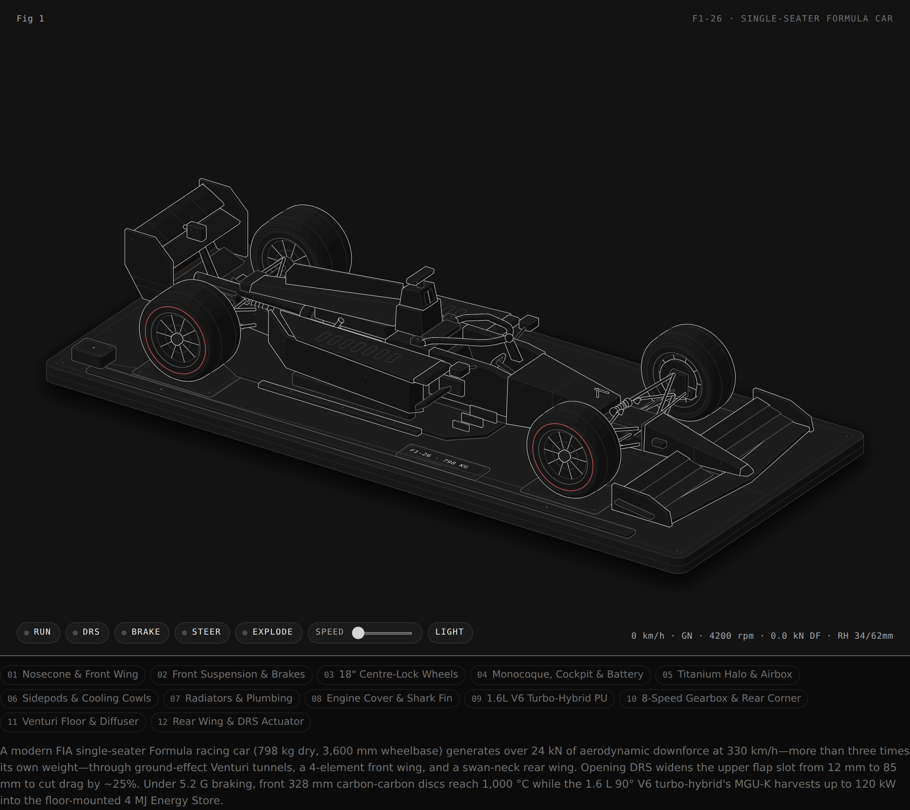
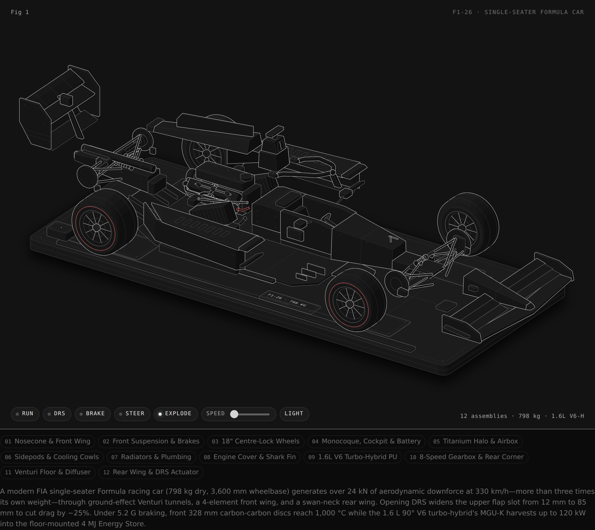
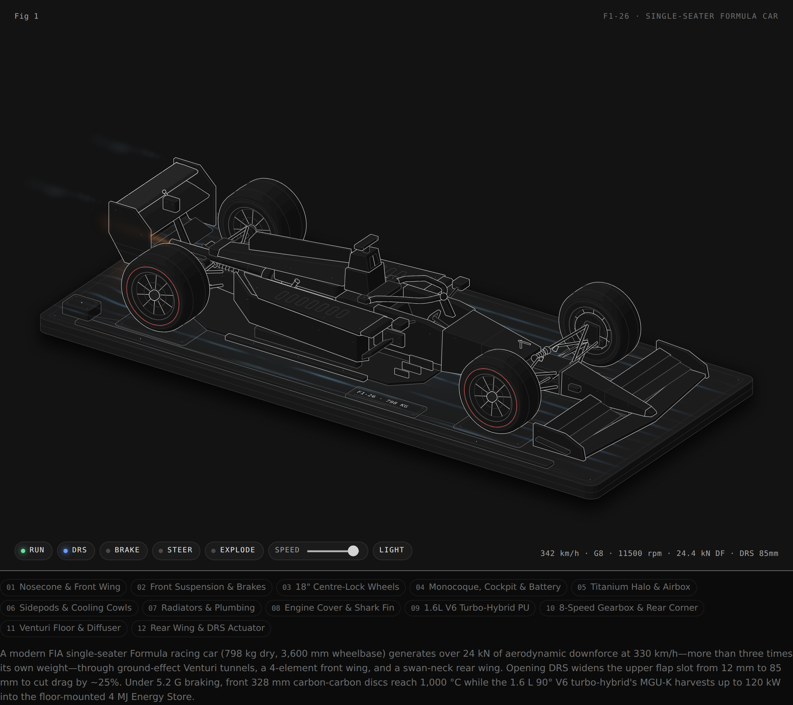
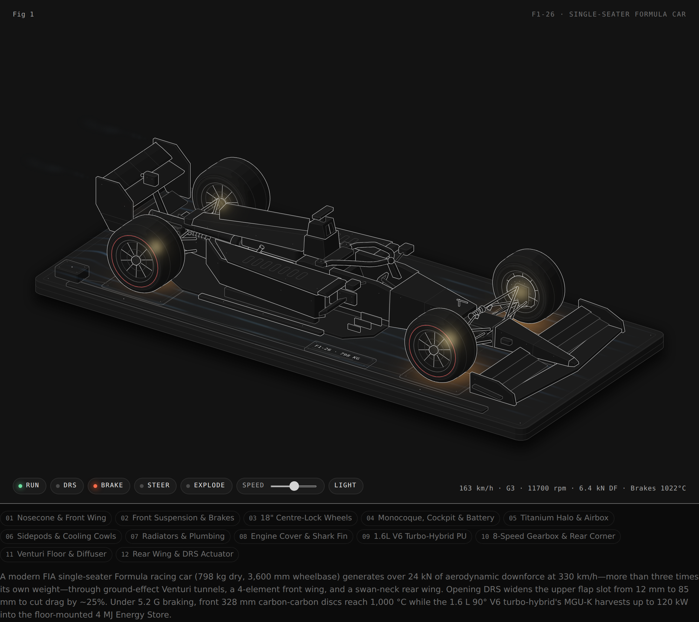
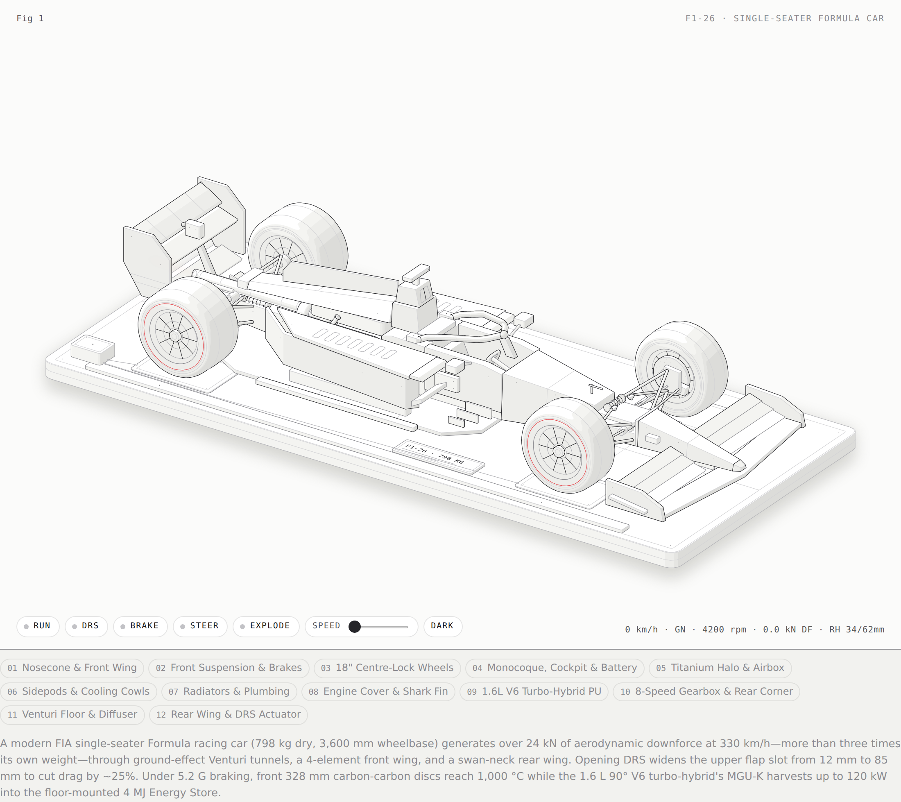
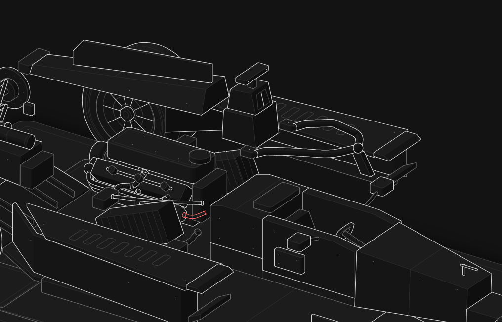

# F1-26 · Single-Seater Formula Racing Car

Interactive isometric Anatomy of a modern FIA single-seater Formula racing car (`798 kg` dry, `3,600 mm` wheelbase) on a machined setup scale pad (`253` depth-sorted items, `225` solids, `19` routed tubes across `12` staggered assemblies).

## Previews

| Assembled (Dark) | Exploded (12 Assemblies) |
|---|---|
|  |  |

| 342 km/h + DRS Open | 5.2 G Carbon Braking Glow |
|---|---|
|  |  |

| Light Theme | Power Unit & Plumbing (4×) |
|---|---|
|  |  |

## Controls

- **Run (`R`) / Speed slider (`0–348 km/h`)**: drives quadratic aero downforce ($>24\text{ kN}$ at $330\text{ km/h}$), suspension ride-height squat, wheel spin, Venturi floor streamlines, exhaust plume, and rear-wing tip vortices.
- **DRS (`D`)**: articulates the rear-wing upper flap (`12 mm → 85 mm` slot gap) and thins tip vortices.
- **Brake (`B`)**: heats carbon-carbon brake discs up to `1,000 °C` with blackbody thermal glow.
- **Steer (`←` / `→`)**: turns front wheels, uprights, steering track rods, and the cockpit butterfly wheel.
- **Explode (`E`)**: staggered spring separation of all 12 assemblies with per-frame depth re-sorting.
- **Light / Dark button**: toggles theme and WebGL paper-ink shaders live.

## Build

```bash
node build.mjs
node build.mjs --light
```
